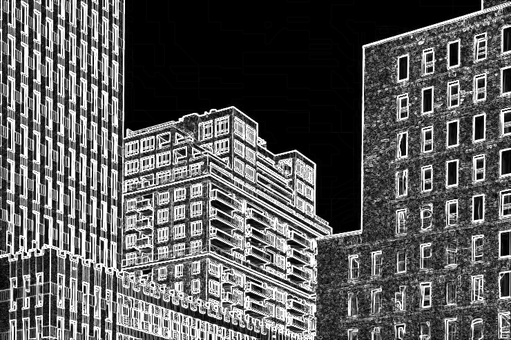
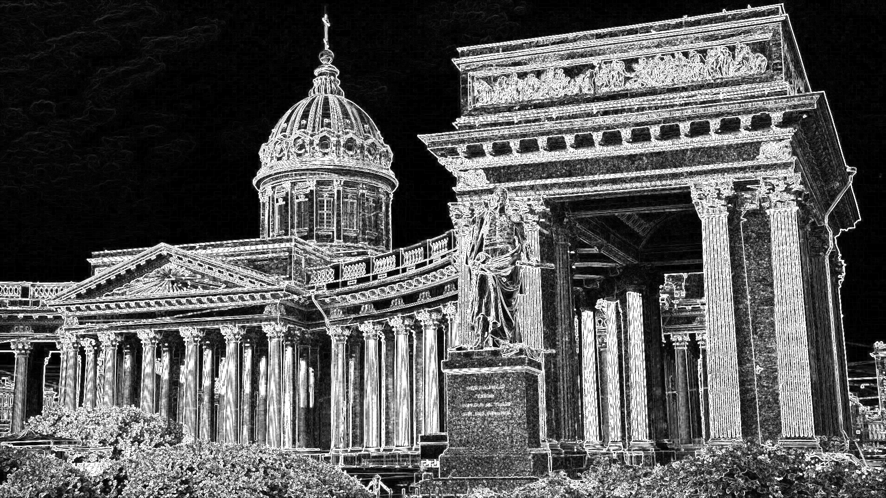

# Лабораторная работа №1. Фильтр Собеля. Вариант 1.
## Цель работы:
### Научиться реализовывать один из простых алгоритмов обработки изображений.

## Теоретическая база
Фильтр Собеля - дискретный дифференциальный оператор, который используется для приближения градиента яркости изображения.
Он основан на свертках с небольшими ядрами.

Исходные данные - изображение A.

Ядро по оси x.

$$
\begin{bmatrix}
-1 & 0 & 1 \\
-2 & 0 & 2 \\
-1 & 0 & 1
\end{bmatrix}
$$

Ядро по оси y.

$$
\begin{bmatrix}
-1 & -2 & -1 \\
0 & 0 & 0 \\
1 & 2 & 1
\end{bmatrix}
$$

Далее промежуточные частные производные по x и y вычисляются с помощью двумерных сверток.

$$
G_x = 
\begin{bmatrix}
-1 & 0 & 1 \\
-2 & 0 & 2 \\
-1 & 0 & 1
\end{bmatrix} * A
$$

$$
G_y = 
\begin{bmatrix}
-1 & -2 & -1 \\
0 & 0 & 0 \\
1 & 2 & 1
\end{bmatrix} * A
$$

Модуль градиента вычисляется по формуле:

$$
G = \sqrt{G_x^2 + G_y^2}
$$

## Описание разработанной системы
Программа написана на Python и состоит из следующих функций
Основная функция main() настройка изображений, замер скорости алгоритмов, сравнение их быстродействия.
Функция sobel_native(img) - применяет нативно реализованный оператор Собеля к изображению.
Функция sobel_cv(img) - применяет оператор Собеля, реализованный с помощью библиотеки OpenCV.

| Исходное изображение |          Нативная реализация           | OpenCV |
|:---:|:--------------------------------------:|:---:|
|  |  |  |

|     Исходное изображение      |            Нативная реализация            |                  OpenCV                   |
|:-----------------------------:|:-----------------------------------------:|:-----------------------------------------:|
|  |  |  |

| Изображение | Native, с | OpenCV, с | Ускорение |
|:-----------:| ---: | ---: | ---: |
|     №1      | 0.431488 | 0.006443 | 67.0 |
|     №2      | 2.539661 | 0.009862 | 257.5 |

 С увеличением разрешения изображения растёт время обработки и абсолютная разница в скорости между реализациями. OpenCV работает значительно быстрее за счёт оптимизированного кода на C++, тогда как нативная реализация использует медленные циклы Python.   

## Выводы по работе
В ходе выполнения лабораторной работы, был изучен фильтр Собеля, который используется для выделения границ объектов.
Были написаны нативная реализация и реализация с помощью библиотеки OpenCV, была замерена скорость выполнения реализаций. 
OpenCV оказался быстрее в 67 и 257,5 раза. Такое различие связано с тем, что OpenCV использует оптимизированные циклы.
## Использованные источники

1. https://algowiki-project.org/ru/Фильтр_Собеля
2. https://habr.com/ru/articles/114452/
3. Р. Гонсалес, Р. Вудс Цифровая обработка изображений — М: Техносфера, 2005 – 1007с